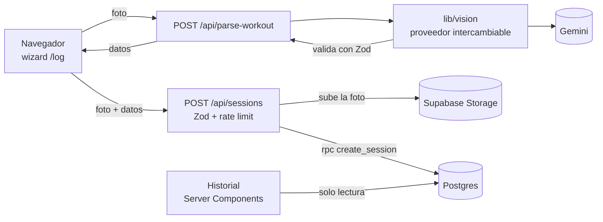

# WOD Tracker 🏋️

App personal para registrar mis entrenamientos de CrossFit. El WOD del día aparece en la pantalla del box (antes, en un pizarrón), y yo terminaba copiándolo a mano a las notas del teléfono: cero registro real de mi progreso y mucha fricción para algo que debería ser simple.

Así que construí esto: le tomo una foto a la pantalla, una IA con visión (Gemini) la interpreta y me arma el registro; yo solo confirmo o ajusto antes de guardar.

**[Ver demo en vivo →](https://wod-tracker-iota.vercel.app/)**

## Cómo funciona

1. Subo una foto del WOD (o la omito y lo lleno a mano).
2. El servidor se la manda a Gemini con un **esquema JSON** que fuerza el formato de la respuesta, y valida lo que regresa antes de mostrarlo.
3. Se pre-llena un wizard de 3 pasos (Calentamiento → Fuerza/Habilidad → WOD). Reviso y edito: ni la IA ni la letra de los coaches son infalibles.
4. Al guardar, **una sola petición** valida todo en el servidor, sube la foto y guarda sesión, bloques y ejercicios en una transacción de Postgres.
5. En el historial filtro por mes/año y abro el detalle de cualquier sesión, con su foto.

Cada ejercicio puede ser `series × reps @ peso` o una **escalera** (`10-15-20-15-10`, `21-15-9`): una lista de repeticiones por ronda con un solo peso. El peso admite kg, lb o % (a veces el WOD pide un porcentaje de tu marca).

## Arquitectura



- **Lectura:** las páginas del historial son Server Components que leen con la anon key.
- **Escritura:** solo el servidor, con la service role, que nunca llega al navegador (`server-only`).
- **Visión aislada:** `lib/vision/` expone `parseWhiteboard()`. Cambiar de proveedor es tocar un archivo.
- **Entrada no confiable en dos capas:** el JSON del modelo y el payload del navegador se validan con Zod. El esquema del modelo es tolerante (normaliza `"LBS"`, descarta lo ilegible) porque el usuario revisa todo; el del guardado es estricto.

```
app/
  api/parse-workout/   foto → entrenamiento (Gemini)
  api/sessions/        guardado (validación + foto + transacción)
  log/                 wizard (page + hook useWorkoutLog)
  history/             listado paginado y detalle
components/log/        ExerciseList, StepIndicator
lib/
  vision/              interfaz + implementación de Gemini
  *-schema.ts          esquemas Zod (respuesta del modelo / payload de guardado)
  log-form.ts          lógica pura del formulario
  rep-scheme.ts        parseo de escaleras
supabase/migrations/   el esquema, versionado
types/supabase.ts      generado (npm run db:types)
```

## Seguridad y compromisos

- **Sin autenticación**, a propósito: es una app de un solo usuario. A cambio, el contenido es legible por cualquiera que tenga la anon key (que va en el bundle). Para multiusuario habría que agregar Supabase Auth y policies por `user_id`.
- **La base solo se puede escribir desde el servidor.** RLS está activo y la anon key solo tiene `SELECT`; no puede insertar, modificar, borrar ni subir al bucket. Las policies están en las migraciones, no en el dashboard.
- **Subidas validadas:** solo JPG/PNG/WebP/HEIC (no SVG) y máximo 4 MB (el límite de Vercel para el cuerpo de una petición es 4.5 MB).
- **Rate limit en memoria** (5 lecturas de foto y 20 guardados cada 10 min por IP). En serverless cada instancia lleva su propio contador, así que frena abuso casual pero no a alguien decidido; para garantizarlo haría falta un almacén compartido (Upstash, Vercel Firewall).
- **Las fotos viven en un bucket público** (se muestran por su URL).
- **Privacidad:** la foto se envía a la API de Gemini. Revisa los términos de tu nivel de uso antes de subir fotos con personas.

## Desarrollo

```bash
git clone https://github.com/MontseOrtiz/wod-tracker.git
cd wod-tracker
npm install
cp .env.example .env.local   # y llena tus valores
npm run dev
```

| Script | Qué hace |
|---|---|
| `npm test` | Tests unitarios (Vitest) de la lógica pura en `lib/` |
| `npm run typecheck` | `tsc --noEmit` |
| `npm run lint` | ESLint |
| `npm run db:types` | Regenera `types/supabase.ts` desde la base vinculada |

**Base de datos** (con el [CLI de Supabase](https://supabase.com/docs/guides/cli)): `supabase link --project-ref <ref>` y `supabase db push` aplican las migraciones de `supabase/migrations/`. Las migraciones son aditivas salvo la última (`close_anon_writes`), que solo debe aplicarse cuando la versión que guarda por servidor ya está desplegada.

## Limitaciones conocidas

- Una foto de más de 4 MB se rechaza; falta comprimir en el cliente antes de subirla.
- La hora de cada sesión en el historial se formatea en el servidor (UTC en Vercel).
- Fuera del flujo de guardado no hay tests de interfaz ni de extremo a extremo.

## Lo que sigue

- Sugerir el peso de la última vez en cada ejercicio y autocompletar nombres desde mi historial.
- Gráficas de progreso por ejercicio (volumen de las escaleras incluido).
- Editar y borrar sesiones.
